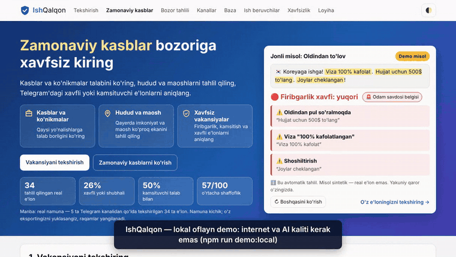
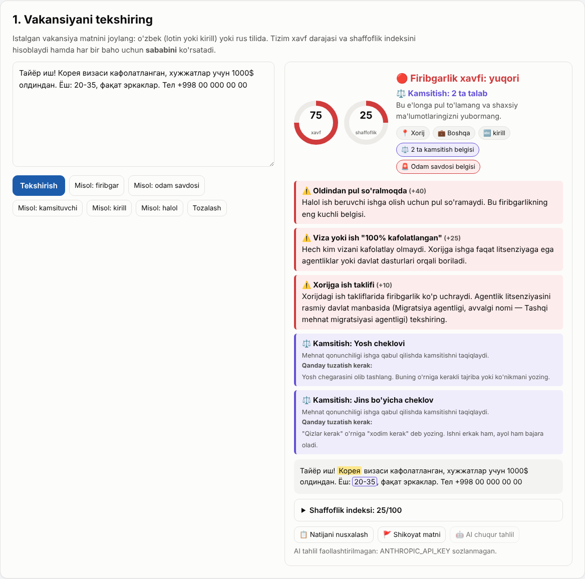
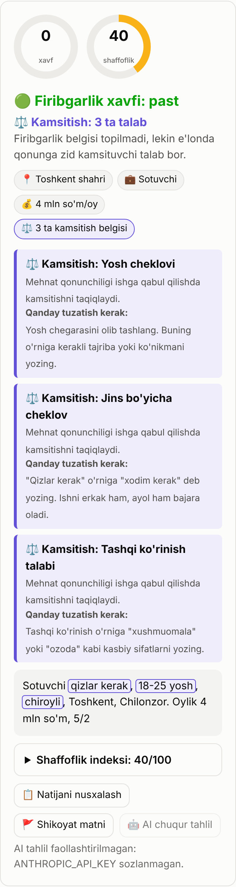
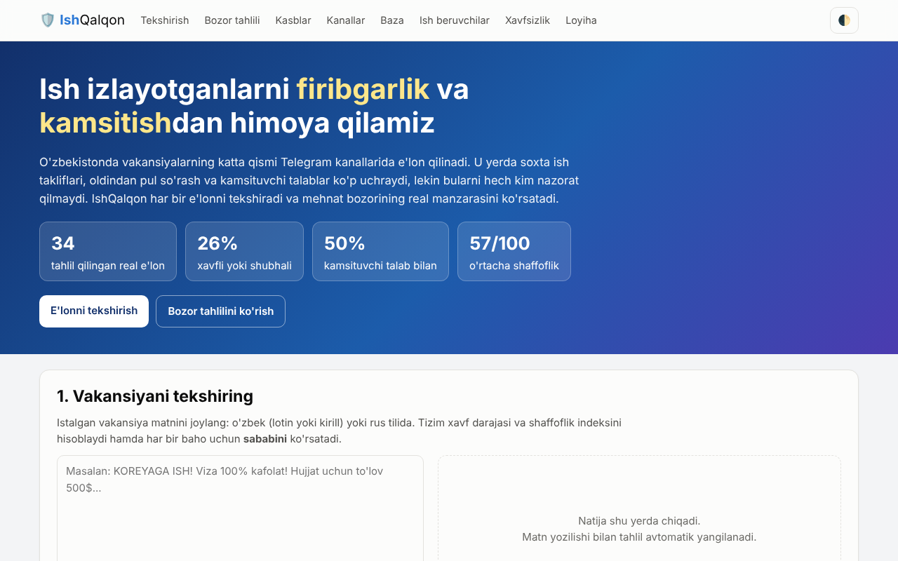
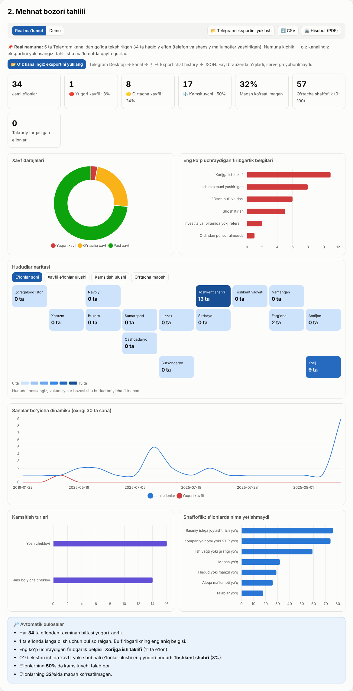
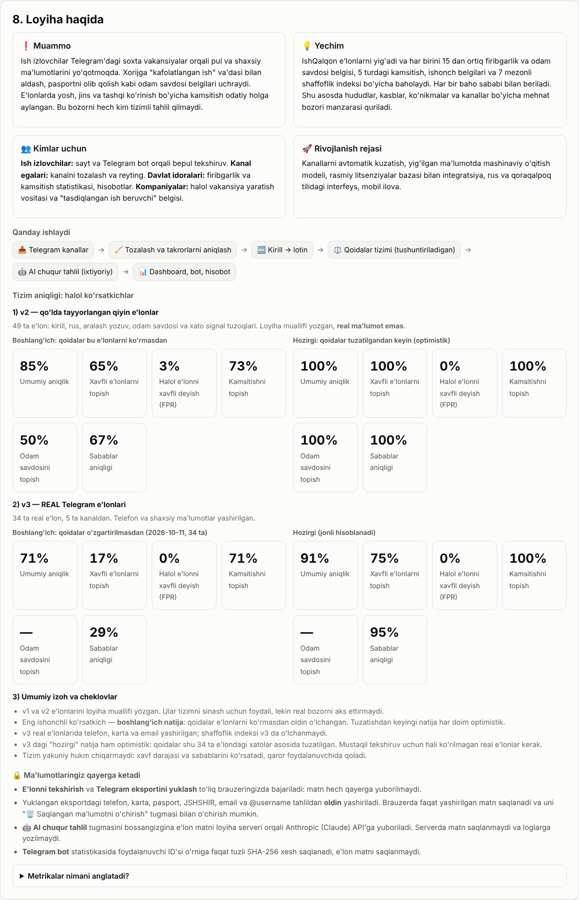

# 🛡️ IshQalqon

Zamonaviy kasblar bozori, hududlar va maoshlar tahlili hamda ish e'lonlarini firibgarlik, odam savdosi belgilari va kamsitishga tekshirish.

**🌐 Onlayn versiya:** https://hikmatillo-dev.github.io/HR/ (GitHub Pages). Agar manzil ochilmasa, `index.html` ni brauzerda oching: sayt internetsiz ham ishlaydi.

## Hakam uchun 1 daqiqa

**Bir jumlada:** IshQalqon yoshlarni zamonaviy kasblar bozoriga xavfsiz kirishga yordam beradigan platforma.

**Nima beradi:**
1. **Kasblar va ko'nikmalar.** Telegram'dagi ish e'lonlaridan qaysi kasb va ko'nikmalar so'ralayotganini ko'rsatadi: raqamli va an'anaviy ko'nikmalar, sohalar.
2. **Hudud va maosh.** Qaysi hududda qancha e'lon borligini va maosh oralig'ini ko'rsatadi. Xarita, dinamika va sohalar bo'yicha maosh bor.
3. **Xavfsiz vakansiyalar.** Har bir e'lonni firibgarlik, odam savdosi belgilari va kamsitishga tekshiradi. Baho **sababi va matndagi aniq iqtibos** bilan beriladi.

**Demo oqimi (3 qadam):**
1. **E'lon tekshirish.** "1. Tekshirish" bo'limiga e'lon matnini qo'ying yoki "Misol" tugmasini bosing → **Tekshirish**.
2. **Telegram eksport.** "2. Bozor tahlili" → **📂 Telegram eksportini yuklash** → Telegram Desktop'dan olingan `result.json`. Sinash uchun **sintetik** namunaviy fayl: `namuna/telegram-export-namuna.json` (real kanal emas).
3. **Kasblar, ko'nikmalar, hududlar.** Xarita, "3. Kasblar" va "4. Kanallar" reytingi yuklangan ma'lumot asosida yangilanadi.

**Ishga tushirish va testlar:**
```bash
npm install
npm start          # http://localhost:3000 (.env dagi AI kaliti bo'lsa, AI ham yoqiladi)
npm run demo:local # http://127.0.0.1:3000 — oflayn demo, kalit kerak emas, AI tugmasi o'chiq
npm test           # 175 ta unit test + aniqlik o'lchovi (v1, v2, v3) va sifat chegaralari
npm run test:ui    # 49 ta brauzer testi (Playwright): mobil, klaviatura, kontrast
npm run preflight  # topshirishdan oldin: kalitlar, taqiqlangan fayllar, hujjatlar va barcha testlar
```

**AI'siz ham ishlaydi.** Asosiy tahlil — tushuntiriladigan qoidalar. Ular brauzerda, internetsiz va bepul ishlaydi. AI (Claude yoki Gemini) faqat **ixtiyoriy chuqur tahlil qatlami**: u kalit bilan `npm start` orqali yoqiladi va qoidaviy natijaning o'rnini bosmaydi.

**Halol cheklovlar (qisqa):**
- Real to'plam kichik: 5 ta Telegram kanalidan 34 ta e'lon. Qoidalar shu xatolar asosida tuzatilgani uchun hozirgi 91.2% natija optimistik. Halol ko'rsatkich — qoidalar o'zgartirilmasdan olingan boshlang'ich natija: 70.6% aniqlik, xavfli e'lonni topish 16.7%.
- v3 da 6 ta e'lon hali noto'g'ri baholanadi. Yangi so'z bilan yozilgan firibgarlikni qoidalar o'tkazib yuborishi mumkin.
- Claude API: real kalit bilan sinalmagan (faqat mock testlar).
- Gemini API: real kalit bilan faqat qo'lda sinalgan (avtomatik test mock bilan).
- Telegram bot: real token bilan sinalmagan (faqat soxta Telegram server bilan).
- Valyuta kurslari taxminiy, rasmiy idoralar ro'yxati `verified: false`.

To'liq ro'yxat: [Cheklovlar](#cheklovlar). Qanday qurilgani va qarorlar: [`docs/JARAYON.md`](docs/JARAYON.md). Taqdimot va savol-javoblar: [`docs/TAQDIMOT.md`](docs/TAQDIMOT.md).

<p></p>

<p>
  
  
</p>

<details><summary>Boshqa skrinshotlar</summary>




</details>

Eslatma: bu skrinshotlar va GIF yangi bosh sahifa matnidan oldin olingan. Yangi 5 ta screenshot ro'yxati va olish tartibi: [`docs/SCREENSHOTS.md`](docs/SCREENSHOTS.md). Oflayn demo video: [`docs/VIDEO_DEMO.md`](docs/VIDEO_DEMO.md).

## Muammo

O'zbekistonda ko'p ish e'lonlari Telegram kanallarida joylanadi. Yosh odam u yerda zamonaviy kasblar haqida ham, xavfli takliflar haqida ham bir oqimda o'qiydi. Oldindan pul so'rash, "kafolatlangan viza", pasportni olib qolish va yosh yoki jins bo'yicha cheklov uchraydi, lekin ularni tizimli tekshiradigan vosita yo'q. Real namunamizdagi 34 ta e'londan 17 tasida (50%) yosh yoki jins cheklovi bor (inson belgilagan).

## Natijalar: halol raqamlar

| To'plam | Fayl | Manba | Hajm | Boshlang'ich natija (qoidalar ko'rmasdan) | Hozirgi natija |
|---|---|---|---|---|---|
| **v1** | `js/test-set.js` | qo'lda yozilgan | 38 | — (qoidalar shu e'lonlar asosida yozilgan) | regressiya testi |
| **v2** | `js/test-set.js` | qo'lda yozilgan, qiyin holatlar | 49 | aniqlik 85.4%, xavfli topish 64.7%, FPR 3.2% (48 ta e'londa) | v1+v2: 100.0% (optimistik) |
| **v3** | `js/test-set-v3.js` | **real Telegram e'lonlari**, 5 kanal | 34 | aniqlik 70.6%, xavfli topish 16.7% (2/12) | aniqlik 91.2%, xavfli topish 75.0% (9/12), FPR 0.0% (0/22) |

**91.2% nimani bildiradi:** 34 ta real e'londan 31 tasida tizim "xavfli yoki xavfsiz" degan qarorni inson belgisi bilan bir xil chiqaradi. Qoidalar aynan shu 34 ta e'londagi xatolar asosida umumiy holatga keltirib tuzatilgan. Shuning uchun bu yakuniy real aniqlik emas, optimistik natija. Mustaqil tekshiruv uchun hali ko'rilmagan e'lonlar (v4) kerak. `npm test` v3 natijasi boshlang'ich natijadan pasaysa xato beradi.

`npm test` uchala to'plamni alohida hisoblaydi va quyidagi hollarda xato beradi:
- test e'lonlarining formati buzilsa yoki ularda yashirilmagan raqam qolsa;
- v1+v2 sifat chegaralari buzilsa (xavfli topish ≥ 90%, FPR ≤ 10%, kamsitish ≥ 85%, odam savdosi ≥ 80%);
- v2 natijasi `tests/results/v2-reference.json` dagidan 5 punktdan ko'p pasaysa;
- v3 natijasi boshlang'ich natijadan yomonlashsa.

Batafsil xatolar ro'yxati: `node tests/run.mjs --verbose`.

<a id="cheklovlar"></a>
## Cheklovlar

Hakamlar va foydalanuvchilar uchun halol holat:

- **Real to'plam kichik.** v3: 5 ta kanaldan 34 ta e'lon. Boshlang'ich natija: aniqlik 70.6%, xavfli topish 16.7%. Tuzatilgandan keyin: 91.2% / 75.0%, FPR 0.0%, kamsitish 100.0%. Bu natija optimistik (yuqoriga qarang).
- **v3 da 6 ta e'lon hali to'g'ri baholanmaydi:** v3-003, v3-028 (xavfli, lekin ba'zi belgilar topilmaydi); v3-007, v3-011, v3-033 (qoidalar ish va talab mos kelmasligini sezmaydi); v3-034 (tizim "xorijga ish + to'lov" ni odam savdosi belgisi deydi, inson belgisida bu yo'q — qaror kutilmoqda).
- **Qoidalar kalit so'zlarga tayanadi.** `tests/rules.test.mjs` dagi sun'iy e'lonlar to'g'ri ajratiladi, lekin bu ham qo'lda yozilgan to'plam. Yangi so'z yoki imlo bilan yozilgan firibgarlikni o'tkazib yuborishi, kutilmagan iborani noto'g'ri belgilashi mumkin.
- **Bozor tahlili kichik namunada.** Sukut bo'yicha sayt 34 ta real e'lonni ko'rsatadi. Kasblar bo'limi 30 tadan kam ishonchli e'londa grafik o'rniga "Ma'lumot yetarli emas" deydi. 600 ta sintetik e'lon faqat **Demo** rejimida, "DEMO" belgisi bilan ko'rinadi. Bosh sahifadagi jonli misollar ham sintetik va "Demo misol" deb belgilangan.
- **Claude API: real kalit bilan sinalmagan.** Xato holatlari soxta (mock) API bilan 14 ta avtomatik testda tekshirilgan.
- **Gemini API: real kalit bilan faqat qo'lda sinalgan.** Muallif bepul kalit bilan lokal ishlatib ko'rgan. Avtomatik testlar (13 ta) mock API bilan.
- **Telegram bot: real token bilan sinalmagan.** `/start`, `/help`, `/check` va `/stats` soxta Telegram server bilan 21 ta testdan o'tgan.
- **GitHub Pages** uchun repozitoriy tayyor (`.nojekyll`, nisbiy yo'llar), lekin onlayn manzil ishlab chiqish muhitidan ochib tekshirilmagan.
- **CI** (GitHub Actions) faqat `npm test` ni ishga tushiradi. Brauzer testlari (`npm run test:ui`) lokal ishga tushiriladi.
- **Valyuta kurslari taxminiy:** 1 USD = 12 600, 1 EUR = 13 700, 1 RUB = 150 so'm. Kurslar `config/currency.js` da va `.env` orqali almashtiriladi, UI'da "Kurslar taxminiy" belgisi chiqadi. Lekin `js/analyzer.js` hali config'ga ulanmagan (pastga qarang). Kurslar faqat maosh baholashga ta'sir qiladi.
- **Rasmiy idoralar tasdiqlanmagan.** `config/official-sources.js` dagi manbalar `verified: false`: ular veb-qidiruvda topilgan, lekin `gov.uz` sahifalari ishlab chiqish muhitidan ochilmadi. UI'da "tekshirilmagan" belgisi chiqadi.
- **Brauzerlar:** UI testlari Chromium'da ishlaydi. Safari va Firefox, shuningdek ekran o'quvchi bilan qo'lda tekshiruv qilinmagan.

### Kutilayotgan ishlar
Bu o'zgarishlar `js/analyzer.js` ga tegadi, shuning uchun alohida qaror bilan qilinadi.
1. **`js/analyzer.js` ni `config/currency.js` ga ulash.** Shundan keyin `.env` dagi `IQ_RATE_*` maosh hisobiga ham ta'sir qiladi. Hozircha `tests/config.test.mjs` ikkala joydagi qiymat bir xilligini tekshiradi.
2. **Agentlik nomini rasmiy manbadan tasdiqlash** va `config/official-sources.js` da `verified: true` qilish.

## Imkoniyatlar

| Bo'lim | Nima qiladi |
|---|---|
| **Bosh sahifa** | "Zamonaviy kasblar bozoriga xavfsiz kiring": 3 ta qiymat, 2 ta asosiy harakat (tekshirish, kasblar), real namuna raqamlari va ularning manbasi, sintetik jonli misol. |
| **1. Tekshirish** | Xavf bali (0–100) va shaffoflik indeksi (0–100). Har bir belgi uchun sabab va matndagi aniq ibora. Firibgarlik xavfi va kamsitish alohida, odam savdosi belgisi alohida ko'rsatiladi. Bo'sh yoki mazmunsiz matnga ("abc") baho berilmaydi. O'zbek (lotin, kirill) va rus tili. |
| **2. Bozor tahlili** | Real / Demo rejimlari va import hisoboti: xabarlar, vakansiyaga o'xshash, takroriy, noyob, xavf taqsimoti. Ko'rsatkichlar, hududlar xaritasi, dinamika, avtomatik xulosalar, CSV va PDF (chop etish). |
| **3. Kasblar** | Talab va maosh xaritasi, ko'nikmalar (raqamli va an'anaviy), sohalar bo'yicha maosh. Ma'lumot kam bo'lsa — "Ma'lumot yetarli emas". |
| **4. Kanallar** | Telegram kanallarga A–F reyting: yuqori xavf to'liq, o'rtacha xavf va kamsitish yarim og'irlik bilan. |
| **5. Baza** | Filtrlash va qidirish mumkin bo'lgan vakansiyalar ro'yxati. |
| **6. Ish beruvchilar** | Halol va kamsitishsiz vakansiya yaratuvchi. |
| **7. Xavfsizlik** | 10 ta qoida va xorijga ketishdan oldingi tekshiruv ro'yxati. |
| **8. Loyiha** | Aniqlik ko'rsatkichlari: boshlang'ich (notanish e'lonlar) va hozirgi natija alohida. |
| **AI (ixtiyoriy)** | Claude yoki Gemini orqali xulosa, iqtiboslar bilan sabablar, odam savdosi belgilari, yetishmayotgan ma'lumotlar, ish beruvchiga beriladigan savollar va kamsitishsiz variant. |
| **Telegram bot** | E'lonni `/check` bilan yuborish yoki forward qilish orqali tekshirish; `/stats`. |

## Ishga tushirish

### 1. Saytni ochish (eng oddiy usul)
`index.html` ni brauzerda oching. Internet va o'rnatish kerak emas: Chart.js ham `vendor/` ichida. AI'dan boshqa hamma narsa ishlaydi.

**Lokal oflayn demo (taqdimot va video uchun):** `npm run demo:local` → http://127.0.0.1:3000. Server faqat shu kompyuterda ochiladi, `.env` o'qilmaydi va muhitdagi AI kalitlari serverga berilmaydi. "🤖 AI chuqur tahlil" tugmasi o'chiq turadi va yonida sababi yoziladi. Demo uchun eksport: `namuna/telegram-export-namuna.json` — **sintetik** fayl, real kanal emas.

### 2. Real Telegram eksportini yuklash
1. **Telegram Desktop** → ish kanali → ⋮ → **Export chat history**
2. Formatni **"Machine-readable JSON"** qilib tanlang. Rasm va videolarni belgilamang.
3. 8–15 ta kanal uchun takrorlang: Toshkent, viloyatlar va "xorijda ish" kanallari.
4. Saytda **2. Bozor tahlili → 📂 Telegram eksportini yuklash** tugmasini bosing. Bir nechta `result.json` ni birdaniga tanlash mumkin.
5. Import hisobotini tekshiring: nechta xabar o'qildi, nechta takror olib tashlandi, nechta e'lon tahlil qilindi.

Fayl **faqat brauzerda** o'qiladi va serverga yuborilmaydi. Telefon, karta, JSHSHIR, pasport (lotin yoki kirill seriya), email, `t.me` havolalari (yopiq guruh taklifi ham) va `@username` tahlil va `localStorage` ga saqlashdan **oldin** yashiriladi. Niqob formatni saqlaydi (`+998 00 000 00 00`), shuning uchun shaffoflik bahosi o'zgarmaydi. O'chirish uchun "🗑️ Saqlangan ma'lumotni o'chirish" tugmasini bosing. Sinash uchun sintetik namunaviy fayl (real kanal emas): `namuna/telegram-export-namuna.json`.

Ma'lumotni doimiy fayl sifatida saqlash uchun: `python3 tools/telegram_export.py k1/result.json k2/result.json` → `js/real-data.js`. Skript ham xuddi shu qoidalar bilan yashiradi. Ismlar haqida ogohlantirish beradi: faylni commit qilishdan oldin uni qo'lda tekshiring.

### 3. AI'ni yoqish
```bash
npm install
cp .env.example .env          # ANTHROPIC_API_KEY (Claude) yoki GEMINI_API_KEY (Google Gemini) ni to'ldiring
npm start                     # http://localhost:3000 — .env avtomatik o'qiladi (Node.js 20.12+)
# eski Node.js uchun: npm run start:env  (20.6+)  yoki  ANTHROPIC_API_KEY=sk-ant-... npm start
```
Kalit bo'lmasa server baribir ishlaydi. Bunda tugma o'chiq turadi va "AI tahlil faollashtirilmagan: ANTHROPIC_API_KEY yoki GEMINI_API_KEY sozlanmagan." degan yozuv chiqadi. Soxta AI javobi hech qachon ko'rsatilmaydi.

**Ikki provayder.** Claude (`ANTHROPIC_API_KEY`) yoki Google Gemini (`GEMINI_API_KEY`, aistudio.google.com da bepul limit bilan olinadi). Ikkala kalit bo'lsa Claude ishlatiladi; aniq tanlash uchun `IQ_AI_PROVIDER=gemini`. Gemini modeli sukut bo'yicha `gemini-flash-latest` (Google o'zi yangi Flash modelga yo'naltiradi), `IQ_GEMINI_MODEL` bilan almashtiriladi. Ikkala yo'lda bir xil promt, bir xil qat'iy sxema tekshiruvi, prompt injection himoyasi va iqtiboslarni tekshirish ishlaydi. Gemini kutubxonasiz, oddiy `fetch` bilan chaqiriladi; kalit URL'da emas, sarlavhada yuboriladi. Server ishga tushganda qaysi provayder va model ishlatilayotganini yozadi. Eslatma: Gemini'ning bepul rejimida Google yuborilgan matnni o'z xizmatlarini yaxshilash uchun ishlatishi mumkin.

**Birinchi real sinov:** saytda "Misol: odam savdosi" → "🤖 AI chuqur tahlil" ni bosing. Javobda iqtiboslar bilan sabablar, savollar va xulosa chiqishini tekshiring.

AI cheklovlari: matn 20–6000 belgi bo'lishi kerak, uzun matn kesilmaydi va rad etiladi. Vaqt chegarasi 45 soniya, xatoda 2 marta qayta urinadi. Promt `prompts/analysis.mjs` faylida.

**AI endpoint xavfsizligi (`/api/ai`):**
- Server sukut bo'yicha faqat `127.0.0.1` da tinglaydi. Tarmoqqa ochish uchun `HOST=0.0.0.0` beriladi, bunda ogohlantirish chiqadi.
- Faqat `Content-Type: application/json` qabul qilinadi, boshqalariga 415 qaytadi. Shuning uchun boshqa sayt oddiy forma yoki `text/plain` so'rov bilan kalitingizni sarflay olmaydi.
- `Origin` bo'lsa, u Host bilan bir xil bo'lishi kerak, aks holda 403 qaytadi. Qo'shimcha domenlar `IQ_ALLOWED_ORIGINS` orqali ruxsat etiladi.
- **Limitlar:**
  - bitta IP dan daqiqasiga `IQ_AI_PER_MINUTE` (10) ta;
  - kunlik `IQ_AI_DAILY_LIMIT` (200) ta;
  - limit tugasa 429 va tushunarli xabar qaytadi;
  - kunlik hisob `data/ai-usage-server.json` da saqlanadi, shuning uchun server qayta ishga tushirilsa ham nolga tushmaydi;
  - bo'sh yoki noto'g'ri so'rov limitni sarflamaydi.
- `X-Forwarded-For` faqat `IQ_TRUST_PROXY=<proksilar soni>` berilganda o'qiladi. Aks holda uni soxtalashtirib limitni chetlab o'tish mumkin bo'lardi.
- Loglarda API kalit, bot token, e'lon matni va PII bo'lmaydi: faqat xato turi va tozalangan qisqa xabar yoziladi (`lib/safe-log.mjs`).

**Prompt injection va AI javobi:**
- E'lon matnidagi `<` `>` `&` belgilari AI'ga yuborilishidan oldin escape qilinadi (`&lt;/posting&gt;`). Shuning uchun e'lon ichidagi `</posting>`, `<rule_check>` yoki boshqa teg blokdan chiqa olmaydi.
- Promtda aniq qoida bor: e'lon ichidagi buyruqlar, soxta "system" xabarlari va "e'lon tugadi" kabi iboralar ko'rsatma emas, tahlil qilinadigan ma'lumot. Tekshiruvchini aldashga urinishning o'zi ham xavf belgisi hisoblanadi.
- Javob qat'iy JSON sxema bilan tekshiriladi: sxemada yo'q maydon bo'lsa, javob rad etiladi.
- AI keltirgan har bir iqtibos e'lon matnida haqiqatan borligi tekshiriladi. Registr, bo'shliq va tutuq belgisi farqlari hisobga olinmaydi. Topilmagan iqtibos foydalanuvchiga ko'rsatilmaydi va `warnings` ga yoziladi.

### 4. Telegram botni ishga tushirish
```bash
# @BotFather → /newbot → tokenni .env ga TELEGRAM_BOT_TOKEN= qilib yozing
npm run bot                   # .env dagi token avtomatik o'qiladi
```

**Buyruqlar:**

| Buyruq | Nima qiladi |
|---|---|
| `/start`, `/help` | Bot haqida qisqa ma'lumot va buyruqlar ro'yxati |
| `/check matn`, `/check` → keyingi xabar, yoki e'longa reply qilib `/check` | E'lonni tekshiradi: xavf darajasi, asosiy sabablar (iqtibos bilan), kamsitish, odam savdosi belgisi, tavsiya. AI yoqilgan bo'lsa, AI xulosasi ham qo'shiladi |
| `/stats` | Siz tekshirgan e'lonlar soni, ulardan xavflilari va oxirgi 5 ta natija |
| Oddiy matn yoki forward (shaxsiy chatda) | Faqat qoidalar bilan tekshiradi; AI chaqirilmaydi |

**AI limitlari va guruhlar:**
- AI **faqat `/check`** bilan ishlaydi. Har bir foydalanuvchi uchun limit soatiga `IQ_BOT_AI_PER_HOUR` (5) ta, bot uchun kunlik limit `IQ_AI_DAILY_LIMIT` ta. Limit tugasa foydalanuvchi qachon yana urinish mumkinligi haqida xabar oladi, qoidalar tahlili esa limitsiz ishlayveradi.
- **Guruhlarda** bot faqat `/start`, `/help`, `/check` va `/stats` ga javob beradi. Oddiy xabarlar, noma'lum buyruqlar va boshqa botga yozilgan `/check@BoshqaBot` e'tiborsiz qoldiriladi. Guruhda `/check matn` yoki e'longa reply qilib `/check` yoziladi.

**Qanday ishlaydi:**
- Har bir javob `Bu avtomatik tahlil. Yakuniy qaror o'zingizda.` degan ogohlantirish bilan tugaydi.
- Matn HTML escape qilinadi. Javob 4096 belgidan oshmaydigan xabarlarga qator chegarasida bo'linadi, shuning uchun teg yoki `&amp;` o'rtasidan kesilmaydi.
- 4000 belgidan uzun matn bo'sh qatorlar bo'yicha e'lonlarga bo'linadi va har biri alohida baholanadi. Javobda eng xavfli bo'lak ko'rsatiladi.
- **Maxfiylik.** `data/bot-stats.json` da e'lon matni saqlanmaydi. Telegram `user_id` ham ochiq saqlanmaydi, faqat `SHA-256(tuz:user_id)` xeshi yoziladi. Tuz `IQ_BOT_HASH_SALT` dan yoki avtomatik yaratilgan `data/bot-salt` dan olinadi. `data/` git'ga tushmaydi.
- **Token bo'lmasa yoki noto'g'ri bo'lsa** bot tushunarli xabar bilan chiqadi (exit 1). Bu ikki xil holatda bo'ladi: token formati noto'g'ri bo'lsa yoki Telegram uni rad etsa (401). Agar bir token bilan ikkinchi nusxa ishga tushirilsa (409), bot ham to'xtaydi.

**Real token bilan tekshirish:**
1. Botga `/start` yozing.
2. "Misol: odam savdosi" matnini `/check` bilan yuboring.
3. Halol e'lon yuboring.
4. `/stats` yozing: 2 ta tekshiruv va 1 ta xavfli chiqishi kerak.

### Accessibility
- Xarita kataklari tugma sifatida ishlaydi: Tab bilan o'tiladi, Enter yoki Space bilan filtrlanadi, holati `aria-pressed` orqali bildiriladi.
- Toast xabarlari `aria-live="polite"` hududi orqali ekran o'quvchiga e'lon qilinadi.
- Kasblar grafigida tor ekranda nomlar 12 belgigacha qisqartiriladi va 2 qatorga bo'linadi. Ustma-ust tushadigan yozuv chizilmaydi. To'liq nom tooltip'da va "Jadval ko'rinishida" ro'yxatida bor.
- Kontrast WCAG AA ga mos: matn ≥ 4.5:1, katta matn ≥ 3:1. Bu ikkala rejimda `npm run test:ui` bilan o'lchanadi.
- Sahifadagi birinchi Tab — "Asosiy tarkibga o'tish" havolasi: Enter bosilsa, fokus vakansiya tekshiruv bo'limiga o'tadi, keyingi Tab — matn maydoni.
- Telefon va planshetda (≤ 980px) asosiy amallar kamida 44px: hero CTA'lari, Tekshirish, Tozalash, eksport yuklash, ☰ menyu va 🌓 rejim (44×44), "Boshqasini ko'rish", Real/Demo almashtirgich, bazadagi qidiruv va filtrlar. Mayda misol tugmalari va grafik boshqaruvlari o'zgartirilmagan.

### Sozlamalar (`config/`)
- `config/currency.js`: kurslar, ularning sanasi va manbasi. `.env` dagi `IQ_RATE_USD`, `IQ_RATE_EUR`, `IQ_RATE_RUB`, `IQ_RATES_UPDATED` va `IQ_RATES_SOURCE` bu qiymatlarni almashtiradi. Sana ko'rsatilmasa yoki u 30 kundan eski bo'lsa, UI'da "Kurslar taxminiy" belgisi chiqadi.
- `config/official-sources.js`: rasmiy idoralar ro'yxati. Har biri uchun nom, havola, `verified` holati, tekshirilgan sana va dalil yoziladi. Manbani tekshirganingizdan keyin `verified: true` qiling.


### 5. Testlar
```bash
npm test                 # 15 ta test fayli (175 ta unit test) + tests/run.mjs (aniqlik va sifat chegaralari)
npm run test:ui          # 49 ta brauzer testi (Playwright o'rnatilmagan bo'lsa o'tkazib yuboriladi)
npm run check:evidence   # README va docs dagi raqamlar repozitoriy dalillariga mosligi (testlarni ham sanaydi)
npm run preflight        # topshirish oldidan: .env/data/qoralama git'da yo'qligi, kalitlar (fayllar va git tarixi), hujjatlar, testlar
```
`npm run preflight -- --no-tests` testlarsiz tez ishlaydi; `-- --final` screenshot va video yo'qligini ham xato deb hisoblaydi. Topilgan kalitning o'zi chiqarilmaydi, faqat turi, joyi va uzunligi yoziladi.
| Test fayli | Nimani tekshiradi | Soni |
|---|---|---|
| `tests/importer.test.mjs` | Telegram JSON, CSV, TXT o'qilishi; firibgar e'lonlar ham olinishi; takrorlar; buzilgan va HTML eksport; sintetik namuna belgisi | 10 |
| `tests/redact.test.mjs` | Telefon (UZ, RU), karta, JSHSHIR, pasport (lotin va kirill seriya), email, `t.me` (taklif havolasi ham), `@username` yashirilishi; STIR saqlanishi; validator; v3 qoralamasi | 15 |
| `tests/redact-parity.test.mjs` | `js/pii.js` va `tools/telegram_export.py` bir xil yashirishi (Python bo'lmasa o'tkazib yuboriladi) | 11 |
| `tests/ai.test.mjs` | Claude yo'li mock API bilan: buzilgan JSON, sxema, ortiqcha maydon, refusal, 401, 429, 500+retry, timeout, kalitsiz rejim, prompt injection, to'qilgan iqtibos | 14 |
| `tests/ai-gemini.test.mjs` | Gemini yo'li mock API bilan: kalit sarlavhada, sxema mosligi, prompt injection, SAFETY, MAX_TOKENS, 429+retry, timeout, provayder tanlash | 13 |
| `tests/baseline.test.mjs` | Boshlang'ich natija skripti: qayta yozish taqiqi, `--force` va git tekshiruvi, arxivlash, SHA-256 xeshlar | 11 |
| `tests/bot.test.mjs` | Bot: 4 buyruq, HTML escape, bo'laklash, disclaimer, `/stats` va xeshlangan `user_id`, AI limitlari, guruh qoidalari, soxta Telegram server bilan to'liq oqim | 21 |
| `tests/server-security.test.mjs` | `/api/ai`: Content-Type (415), Origin (403), faqat `127.0.0.1`, kunlik va IP limiti, `X-Forwarded-For`, loglarda kalit va PII yo'qligi | 14 |
| `tests/config.test.mjs` | Config va `analyzer.js` kurslari bir xilligi, `.env` orqali almashtirish, rasmiy manbalar formati | 6 |
| `tests/rules.test.mjs` | Har bir qoida umumiy naqshni topishi va noto'g'ri signal bermasligi (lotin, kirill, rus) | 22 |
| `tests/quote-map.test.mjs` | Kirill e'londa lotincha analyzer iqtibosi asl kirill fragmentga bog'lanishi; topilmasa yoki harfning yarmiga tushsa — belgilanmaydi; lotin va rus belgilari o'zgarmasligi | 8 |
| `tests/validate.test.mjs` | Bo'sh va mazmunsiz matn bloklanishi; loyihadagi barcha real va namunaviy e'lonlar o'tishi | 8 |
| `tests/demo-examples.test.mjs` | Bosh sahifadagi sintetik misollar va ularning iqtiboslari analizator natijasiga mosligi | 7 |
| `tests/demo-local.test.mjs` | `npm run demo:local`: faqat `127.0.0.1`, muhitdagi AI kalitlari berilmaydi, `/api/ai` → 503, `.env` va server fayllari ochilmaydi, loglarda kalit yo'q | 5 |
| `tests/preflight.test.mjs` | Vaqtinchalik git repolarda: `.env`, `data/`, qoralama va `result.json` commit qilinsa, soxta Anthropic/Gemini/Telegram kalitlari faylda, git tarixida yoki yangi faylda bo'lsa, `.gitignore` to'liq bo'lmasa preflight xato beradi va kalitni chiqarmaydi | 10 |
| `tests/run.mjs` | v1, v2, v3 aniqligi, format tekshiruvi, sifat chegaralari | 10 chegara |
| `tests/ui.e2e.mjs` | Brauzerda: 320–1366px ekranlarda gorizontal scroll yo'qligi, menyu, klaviatura, `aria-live`, validatsiya, hero va CTA, CSV formula himoyasi, kanallar reytingi, chop etish, `demo:local` da AI tugmasi o'chiqligi, kirill e'londa asl iqtiboslar belgilanishi va shikoyatda asl fragment, natijaning ekran o'quvchiga e'lon qilinishi, baza qatorini klaviatura bilan ochish, landshaft telefonda mobil menyu, xarita va xulosalardagi xavf ulushi bir xil ta'rifda, sintetik namuna "real" deb ko'rsatilmasligi, "Asosiy tarkibga o'tish" havolasi (Tab → Enter → tekshiruv), 390 va 768px da asosiy amallar ≥ 44px, yorug' va qorong'i rejimda WCAG AA kontrast | 49 |

## Tuzilishi

```
index.html, css/, assets/   sahifa, dizayn, logotip
vendor/chart.umd.js         Chart.js 4.4.1 (lokal nusxa, internet kerak emas)
js/analyzer.js              TAHLIL YADROSI: qoidalar, maosh, hudud, kasb, shaffoflik, odam savdosi
js/validate-posting.js      bo'sh va mazmunsiz matnni tahlildan oldin to'xtatish
js/quote-map.js             analyzer iqtibosini asl (kirill) matndagi fragmentga bog'lash
js/importer.js              Telegram JSON / CSV / TXT importi va takrorlarni aniqlash
js/pii.js                   shaxsiy ma'lumotni topish va yashirish (yagona manba)
js/evaluate.js              aniqlik metrikalari (brauzer va testlar uchun bitta modul)
js/test-set.js              qo'lda belgilangan test to'plami (v1, v2) + v2 boshlang'ich natija
js/test-set-v3.js           REAL Telegram e'lonlari (v3): 34 ta, shaxsiy ma'lumot yashirilgan
js/results-v3-baseline.js   v3 boshlang'ich natija (brauzer uchun, avtomatik)
js/sample-data.js           600 ta SINTETIK e'lon (faqat Demo rejimi)
js/demo-examples.js         bosh sahifadagi SINTETIK jonli misollar
js/real-data.js             ixtiyoriy doimiy real ma'lumot (hozir bo'sh)
js/ui-*.js, js/app.js       interfeys modullari, real/demo rejimlari
tools/redact.mjs            shaxsiy ma'lumotni yashirish va v3 qoralamasi
tools/eval-v3-baseline.mjs  v3 boshlang'ich natijani yozish
tools/check-evidence.mjs    README va docs dagi raqamlarni repozitoriy bilan solishtirish
tools/preflight-submission.mjs  topshirish oldidan kalitlar, taqiqlangan fayllar, hujjatlar va testlar
tools/demo-local.mjs        kalitsiz lokal oflayn demo serveri (127.0.0.1)
tools/telegram_export.py    eksportni js/real-data.js ga aylantirish
config/                     valyuta kurslari va rasmiy manbalar
prompts/analysis.mjs        AI promti va javob sxemasi (Claude va Gemini uchun bitta)
lib/ai.mjs                  Claude va Gemini chaqiruvi, xatolarni boshqarish
lib/bot-core.mjs            bot buyruqlari, formatlash, bo'laklash
lib/bot-store.mjs           /stats: tuzli SHA-256 bilan anonim statistika
lib/ai-quota.mjs            AI kunlik va oyna (IP / foydalanuvchi) limitlari
lib/safe-log.mjs            kalit, token va PII'siz xato logi
lib/env.mjs                 .env faylini o'qish
server.mjs, bot.mjs         veb-server va Telegram bot
tests/                      testlar; tests/results/ — boshlang'ich natijalar va xatolar tahlili
docs/                       JARAYON.md, TAQDIMOT.md, SCREENSHOTS.md, VIDEO_DEMO.md, demo GIF va skrinshotlar
```

## Tahlil qanday ishlaydi

- **Firibgarlik (15 qoida + real bo'lmagan maosh):** oldindan to'lov, karta yoki SMS kod so'rash, pasportni olib qolish, pasport nusxasi, qarz evaziga ishlash, hujjatsiz ishlash, kafolatlangan viza, piramida va referal sxema, topshiriq firibgarligi, "oson pul", shubhali havola, xorij, ko'ngilochar soha, shoshiltirish, yashirin ish mazmuni.
- **Kritik belgilar:** pul, karta yoki SMS kod, pasport yoki qarz so'ralsa, e'lon kamida "yuqori xavf" deb baholanadi.
- **Inkor tushuniladi:** "depozit yo'q", "garov talab qilinmaydi" kabi iboralar xavf belgisi hisoblanmaydi.
- **Odam savdosi:** pasportni olib qolish yoki qarz qulligi; yoxud xorijga ish bilan birga to'lov, kafolatlangan viza, ko'ngilochar soha yoki hujjatsiz ishlash.
- **Kamsitish (5 tur):** yosh, jins, tashqi ko'rinish, oilaviy holat, millat yoki propiska. Har biri uchun qanday tuzatish kerakligi aytiladi.
- **Ishonch belgilari** (STIR, MChJ, rasmiy ishga joylashtirish, manzil) xavfni kamaytiradi. Kritik belgi bo'lsa, ular xavfni kamaytirmaydi.
- **Kirill va rus yozuvi:** qoidalar Unicode rejimida ishlaydi, kirillcha matn lotinga transliteratsiya qilinib ham tekshiriladi.

## Hujjatlar

- [`docs/JARAYON.md`](docs/JARAYON.md) — texnologiya tanlovi, AI qanday ishlatilgani, muammo → test → tuzatish → commit holatlari, xavfsizlik va cheklovlar.
- [`docs/TAQDIMOT.md`](docs/TAQDIMOT.md) — 5 daqiqalik nutq, 5 daqiqalik jonli demo ssenariysi, 15 ta hakam savoliga javob va oflayn zaxira reja.
- [`docs/SCREENSHOTS.md`](docs/SCREENSHOTS.md) — topshirish uchun 5 ta screenshot: o'lcham, rejim, nima ko'rinishi, ma'lumot turi, caption, PII tekshiruvi.
- [`docs/VIDEO_DEMO.md`](docs/VIDEO_DEMO.md) — 90–120 soniyalik oflayn demo video ssenariysi va ekranni yozib olish yo'riqnomasi.

## v3 boshlang'ich natija (avtomatik yoziladi)

Bu blokni `npm run eval:v3-baseline` yozadi; qo'lda o'zgartirilmaydi. Tartib: real e'lonlar `tools/redact.mjs` bilan yashiriladi → tizimga qaramasdan qo'lda belgilanadi → `js/test-set-v3.js` ga qo'shiladi va commit qilinadi → boshlang'ich natija `analyzer.js` ga tegmasdan yoziladi. Natijaga git commit, sana va `analyzer.js`, `evaluate.js`, `test-set-v3.js` ning SHA-256 xeshlari qo'shiladi. Qayta o'lchash `--force` bilan faqat toza repozitoriyda, eski natijani `tests/results/archive/` ga ko'chirib bajariladi.

<!-- v3-baseline:start -->
**v3 boshlang'ich natija** (real e'lonlar, qoidalar o'zgartirilmasdan): 2026-10-11, 34 ta e'lon, commit `ac296f1`

SHA-256: `analyzer.js` `38ceba487377…` · `evaluate.js` `369f131cab8a…` · `test-set-v3.js` `758f4a6fe878…`

| Ko'rsatkich | Natija |
|---|---|
| Umumiy aniqlik | 70.6% |
| Xavfli e'lonlarni topish (recall) | 16.7% (2/12) |
| "Xavfli" deganida to'g'ri bo'lishi (precision) | 100.0% |
| Halol e'lonni xavfli deyish (FPR) | 0.0% (0/22) |
| Kamsitishni topish | 70.6% |
| Odam savdosini topish | — |
| Sabablar aniqligi (kutilgan belgilar topildi) | 28.6% |

Xato bo'lgan testlar (25): v3-001, v3-002, v3-003, v3-004, v3-005, v3-006, v3-007, v3-008, v3-009, v3-010, v3-011, v3-012, v3-013, v3-014, v3-015, v3-016, v3-017, v3-027, v3-028, v3-029, v3-030, v3-031, v3-032, v3-033, v3-034. Tahlil: `tests/results/v3-errors.md`.
<!-- v3-baseline:end -->
